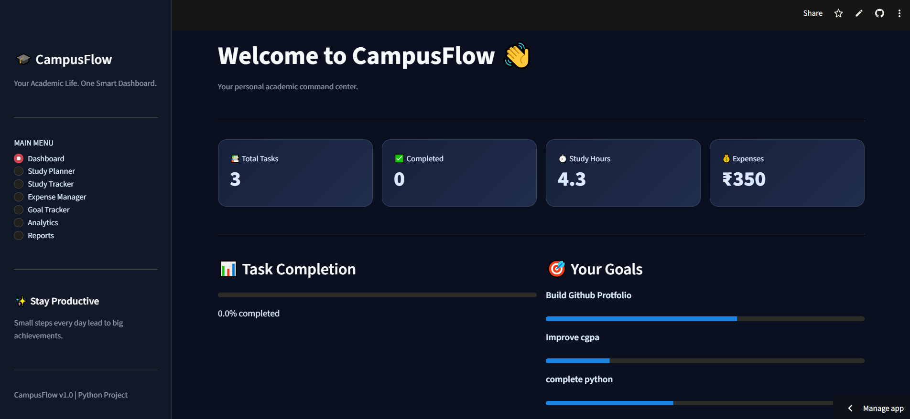
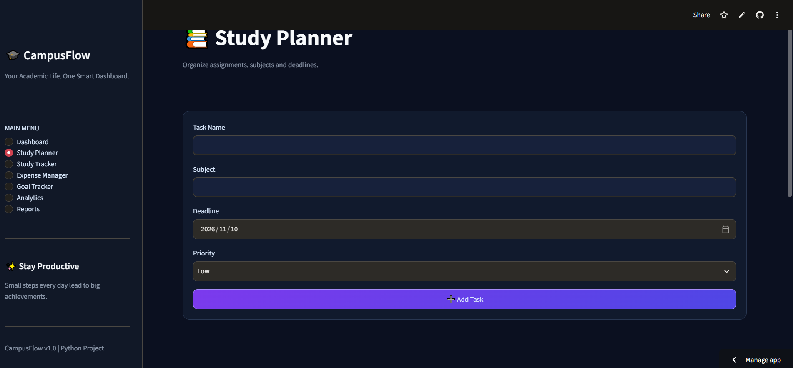
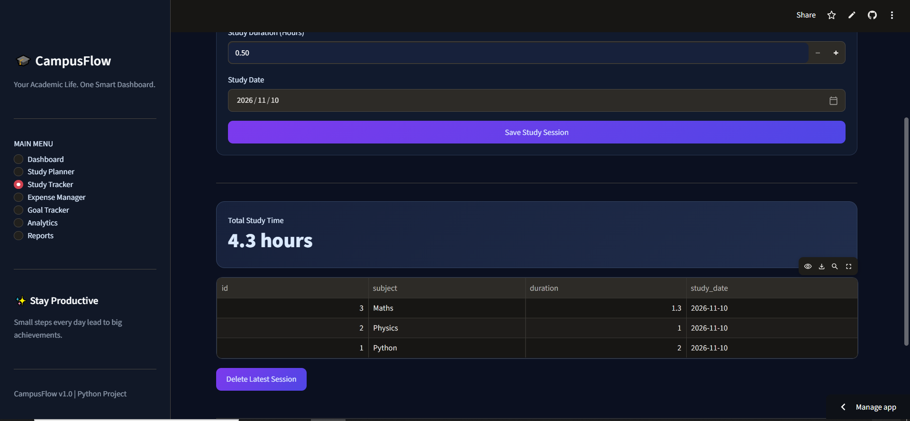
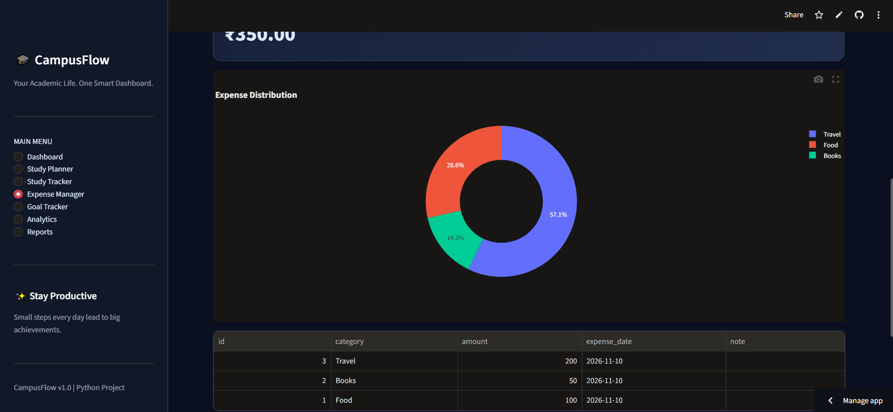
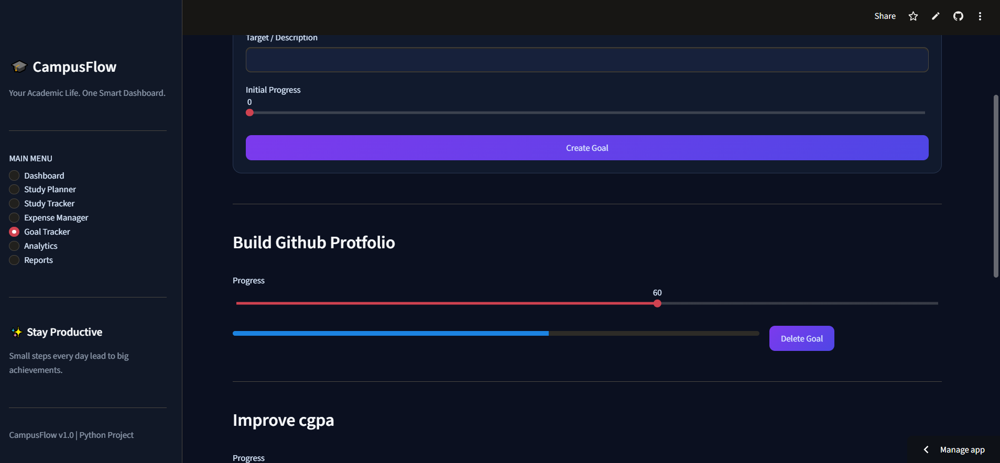
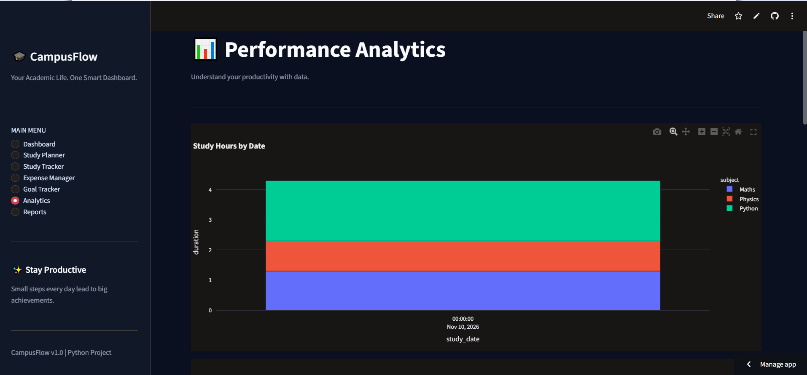

# 🎓 CampusFlow – Smart Student Management System

### Your Academic Life. One Smart Dashboard.

🚀 [View Live Demo](https://campusflow-smart-student-management-system-iehrs9j253maiqkqjpe.streamlit.app/)

💻 [View Source Code](https://github.com/jyotisihagjaat/CampusFlow-Smart-Student-Management-System)

A Python-powered student productivity platform to manage
academic tasks, study sessions, expenses and personal goals.

CampusFlow is a Python-based student productivity and academic
management application designed to help students organize their
academic life in one place.

## ✨ Features

- 📊 Interactive Dashboard
- 📚 Study Planner and Task Management
- ⏱️ Study Session Tracker
- 💰 Student Expense Manager
- 🎯 Academic Goal Tracker
- 📈 Performance Analytics
- 📁 CSV Report Downloads

## 🛠️ Technologies Used

- Python
- Streamlit
- SQLite
- Pandas
- Plotly
- CSS

## 🚀 Installation

Clone the repository:

    git clone YOUR_GITHUB_REPOSITORY_URL

Open the project folder:

    cd CampusFlow

Create a virtual environment:

    python -m venv .venv

Activate it on Windows:

    .venv\Scripts\activate

Install dependencies:

    pip install -r requirements.txt

Run the application:

    streamlit run app.py

## 📂 Project Structure

    CampusFlow/
    ├── app.py
    ├── database.py
    ├── requirements.txt
    ├── README.md
    ├── .gitignore
    ├── assets/
    │   └── style.css
    └── screenshots/

## 🎯 Project Objective

To develop a simple and interactive platform that helps students
manage their tasks, study schedules, expenses and academic goals.

## 👩‍💻 Developer

Jyoti

Built as a Python learning and portfolio project.

## 🔮 Future Improvements

- User authentication
- Cloud database integration
- Smart study recommendations
- Calendar integration
- Mobile-friendly interface

## 📸 CampusFlow Screenshots

### 1. Dashboard

### 2. Study Planner

### 3. Study Tracker

### 4. Expense Manager

### 5. Goal Tracker

### 6. Analytics

